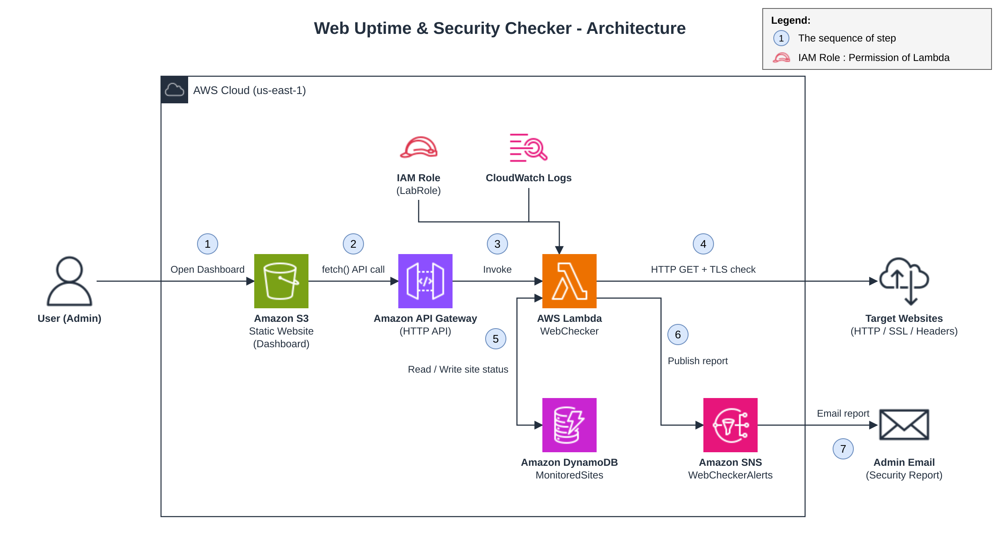

# Web Uptime & Security Checker

โครงการวิชา CS615 Introduction to Cloud Computing Technology (ภาคการศึกษา 1/2569)
ระบบตรวจสถานะและความปลอดภัยของเว็บไซต์แบบ serverless บน AWS Academy Learner Lab

## Scenarios

**Scenario 1: เพิ่มเว็บไซต์และตรวจสถานะทันที**
ผู้ดูแลใส่ URL ผ่านหน้า Dashboard ระบบตรวจ HTTP status code และเวลาตอบสนอง แล้วบันทึกผลลง DynamoDB

**Scenario 2: ตรวจ SSL และ Security Headers แล้วออกรายงาน**
ระบบตรวจวันหมดอายุของใบรับรอง SSL และ security headers 6 ตัว (HSTS, CSP, X-Frame-Options, X-Content-Type-Options, Referrer-Policy, Permissions-Policy) ให้เกรด A–F พร้อมคำแนะนำวิธีแก้ และส่งรายงานทางอีเมลผ่าน SNS ได้

## AWS Services

| Service | หน้าที่ |
|---|---|
| Amazon S3 | โฮสต์หน้า Dashboard แบบ Static Website |
| Amazon API Gateway (HTTP API) | เปิด endpoint ให้หน้าเว็บเรียก Lambda |
| AWS Lambda (Python 3.12) | ตรวจเว็บ วิเคราะห์ SSL และ headers |
| Amazon DynamoDB | เก็บรายการเว็บและผลตรวจล่าสุด |
| Amazon SNS | ส่งรายงานทางอีเมล |
| Amazon CloudWatch Logs | เก็บ log การทำงานของ Lambda |

## ไฟล์ในโปรเจกต์

| ไฟล์ | รายละเอียด |
|---|---|
| `lambda_function.py` | โค้ด Lambda (ใช้เฉพาะ Python standard library และ boto3) |
| `index.html` | หน้า Dashboard สำหรับอัปโหลดขึ้น S3 |
| `docs/architecture.png` | แผนภาพสถาปัตยกรรม |
| `docs/architecture.drawio` | ไฟล์แผนภาพสำหรับแก้ไขใน draw.io |

## การติดตั้งโดยสรุป

1. สร้าง SNS topic `WebCheckerAlerts` และ subscribe อีเมล (กด Confirm ในอีเมล)
2. สร้าง DynamoDB table `MonitoredSites` partition key `url` (String) โหมด On-demand
3. สร้าง Lambda `WebChecker` (Python 3.12, role `LabRole`) วางโค้ดจาก `lambda_function.py`
   - Timeout 1 นาที, Memory 256 MB
   - Environment variables: `TABLE_NAME=MonitoredSites`, `TOPIC_ARN=<ARN ของ SNS topic>`, `SSL_WARN_DAYS=30`
4. เพิ่ม trigger API Gateway (HTTP API, Security: Open) และตั้งค่า CORS ที่ API Gateway
   (Allow-Origin `*`, Allow-Headers `content-type`, Allow-Methods `GET, POST, DELETE, OPTIONS`)
5. แก้ `API_URL` ใน `index.html` เป็น API endpoint แล้วอัปโหลดขึ้น S3 bucket ที่เปิด Static website hosting

## API

| Method | Query | Body | การทำงาน |
|---|---|---|---|
| GET | `?action=list` | – | ดูรายการเว็บทั้งหมด |
| POST | `?action=add` | `{"url": "..."}` | เพิ่มเว็บและตรวจทันที |
| POST | `?action=check` | `{"url": "..."}` | ตรวจเว็บเดิมซ้ำ |
| GET | `?action=report&url=...` | – | ตรวจใหม่และคืนรายงานความปลอดภัย |
| POST | `?action=email_report` | `{"url": "..."}` | ส่งรายงานทางอีเมล |
| POST | `?action=delete` | `{"url": "..."}` | ลบเว็บออกจากรายการ |

## ข้อจำกัดและแนวทางพัฒนาต่อ

- API ตั้งเป็น Security: Open เพื่อความง่ายในการสาธิต การใช้งานจริงควรเพิ่ม Cognito (JWT authorizer), ตั้ง throttling และจำกัด CORS เฉพาะโดเมนของ Dashboard
- ตรวจเฉพาะเมื่อผู้ใช้สั่ง สามารถเพิ่ม EventBridge เพื่อตรวจอัตโนมัติตามรอบเวลาและแจ้งเตือนเมื่อเว็บล่มได้
